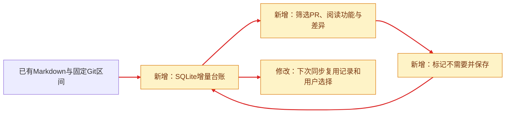

# 上游PR完整适配与增量台账

## Goal

1. 用户读懂每个PR的功能与本地价值，避免凭编号作决定。
2. 完整适配PR2028；用可保存选择、能筛选的本地页面减少重复盘点。

## Requirements

- R1：同步技能当前只允许采用、需讨论、暂缓、跳过；历史片段另记版本与缺口。该规则修改已完成。
- R2：每个PR解释问题、触发场景、效果、用法、本地价值和限制，附来源；未采用给出差异和完整解法。
- R3：PR2028整条适用能力一起适配，保留本地UI外壳、入口、提示词、项目卡和并行会话；完整验证才采用和部署。
- R4：项目内SQLite首次导入265个既有键，后续按固定SHA增量、依赖和本地变更重审，去重保留时间及证据。
- R5：HTML支持状态/权重/依赖组/关键词/我的选择等筛选，能持久标记不需要和撤销，同步不能覆盖；标记不回滚已装代码。
- R6：upstream-changelog.md继续记录采用和验证。新批次仅独立分支；插件经独立验证才更新本机web/desktop，不合dev。

## User-visible Outcomes

- [x] O1（R1）：技能和当前来源表不再使用部分采用状态，保留历史事实与114项余数。
- [x] O2（R2、R3）：PR2028用途、真实差异和完整验收已解释；不声称实现完成。
- [ ] O3（R2、R4）：页面首次加载现有PR，每项有说明与来源，重复导入不重复。
- [ ] O4（R4、R5）：筛选/标记并重启再同步，选择保留，增量只更新变化项。
- [ ] O5（R3、R6）：PR2028实际功能通过独立验收后打包安装，dev保持原样。

原型入口：尚无。预览：尚未生成。状态：设计方案待确认，未记录原型批准。摘要：筛选栏与PR表格，行详情显示功能/差异/方案，选择单独保存。方案见docs/plans/2026-11-26-upstream-catalog.md。

