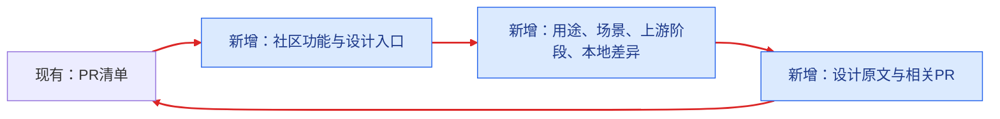

# 上游新功能与设计决策视图

## Goal

1. 用户能先读懂upstream新增或改变了哪些能力，再判断是否适合本地二开。
2. 用可追溯的设计、PR和本地差异支持决定，减少反复全量检索。

## Requirements

### R1 新增

- **R1.1**：增加“社区新功能与设计”入口，按功能展示用途、场景、限制、变化类型、上游实现阶段及其证据；不把设计合入当成完整实现。
- **R1.2**：展示相关实现PR和设计更新PR，本地采用状态、具体暂缓/讨论/跳过原因和解决方式取现有记录；不合并成误导的“部分采用”状态。
- **R1.3**：社区详情和PR详情均可读固定版本设计原文、该PR设计差异和PR链接；无设计变更时明确说明。
- **R1.4**：设计正文、版本、PR关系和人工说明存SQLite；首次补齐历史，后续只补新增/修改/重命名/删除；旧说明遇源变化标重审，失败不推进游标，无变化不刷新时间。

### R2 修改

- **R2.1**：PR清单和“不需要”选择继续可用；新旧入口互通，按用途/阶段/本地相关PR状态筛选社区内容。无设计文件的新功能与修复也能通过单项变更看到。
- **R2.2**：更新技能，约束增量设计评估与网页展示，以帮助采用判断为目标；根记录和CHANGELOG同步留证。
- **R2.3**：仅独立分支写入，dev只读；测试使用台账副本。验证后备份并更新正式管理页，不改日用DSH数据、插件包或自动采用上游代码。

## User-visible Outcomes

- [x] **O1 (R1.1,R1.2)**：用户从社区入口读懂一个功能如何使用、上游阶段、本地为何未采用及完整推进方式。
- [x] **O2 (R1.3,R2.1)**：能力包2019与设置2028可从设计到PR往返；原文/差异有固定SHA链接，无设计项有明确说明，PR筛选和选择保留。
- [x] **O3 (R1.4)**：历史补齐不冒称本次新增；重复零变化，新增/修改/重命名/删除与待重审可验证，失败不推进，旧选择不丢。
- [x] **O4 (R2.2,R2.3)**：独立复核和真实网页验证后服务更新，技能/记录完整，dev及日用DSH保持。

<!-- ui-prototype:START -->
- [ ] **O-PROTOTYPE** Current prototype: [entry](prototype/brief.md);
  preview: ;
  `prototype status: approved`; `digest: sha256:92a08e24eb4f063d1d1e94c2947f401123199a69354b7016950a27c7bebe408c`.
<!-- ui-prototype:END -->

### 交互变化

实现、自动检查、独立复核和正式管理服务更新完成；最终用户验收另计。[实施回执](../../../docs/reviews/2026-11-26-upstream-community-implementation.md)。
