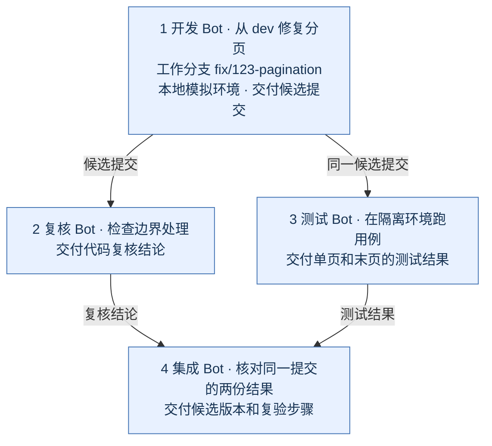
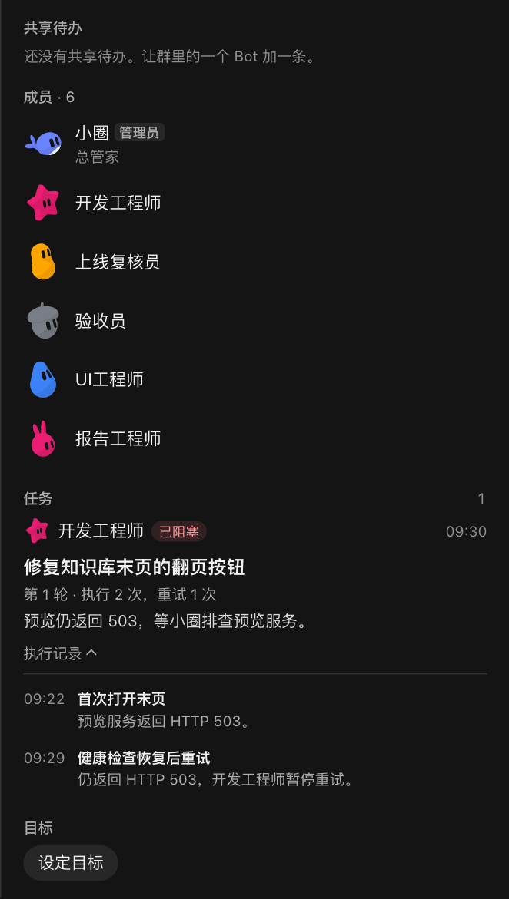
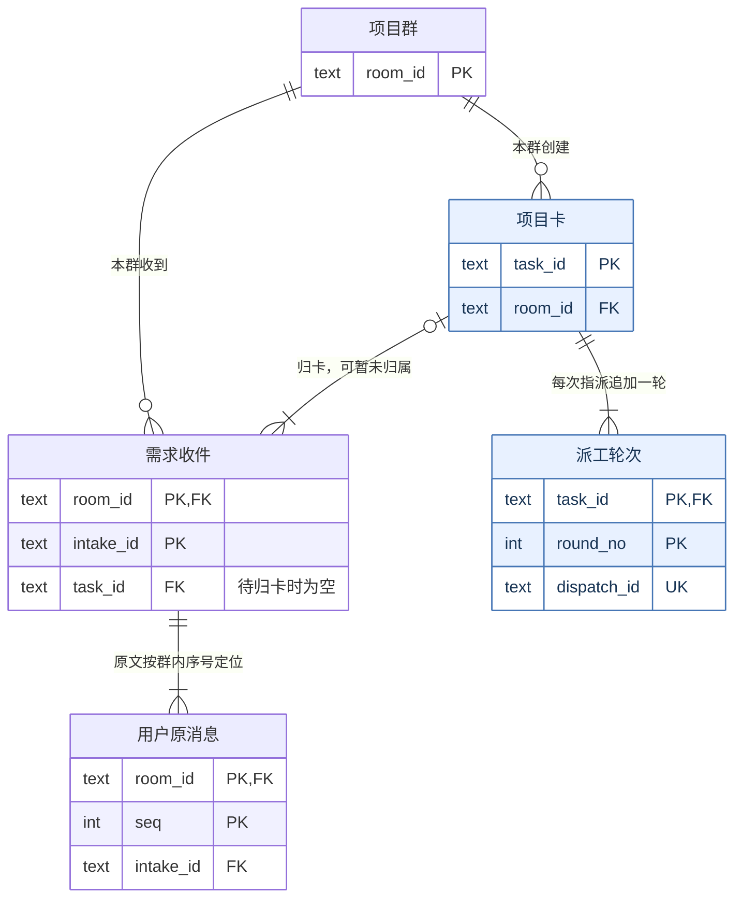
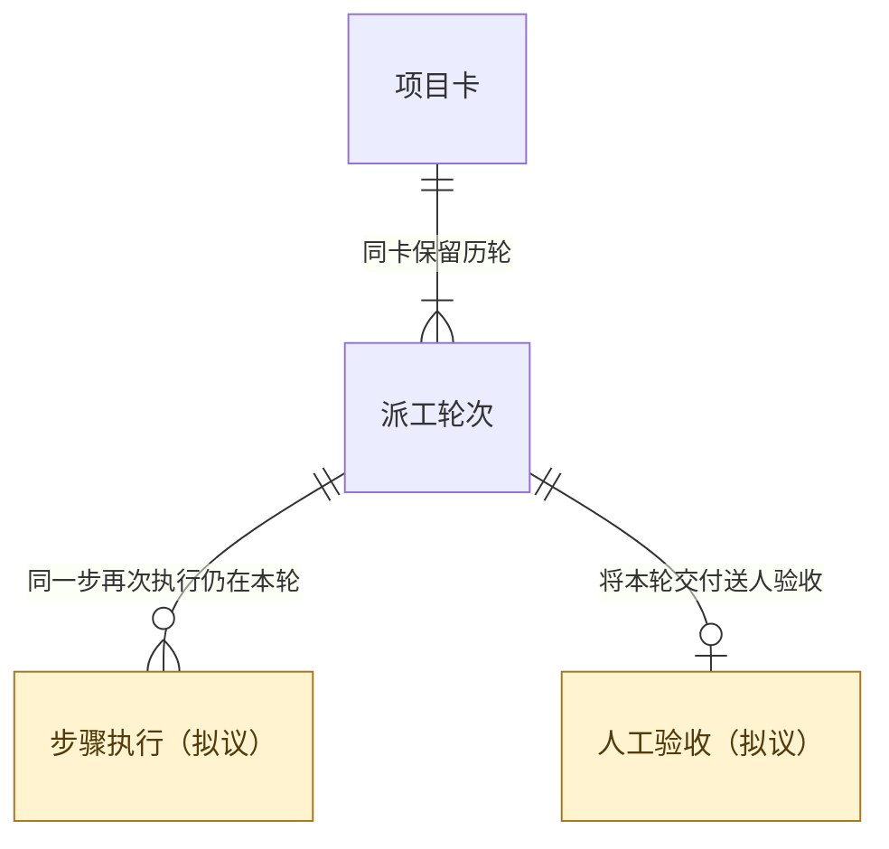

# 项目群任务卡：管理员派工与人工终验

- 日期：2026-11-19
- 相关：[需求及原会话](../bot-task-workflow.zh.md)、[群共享待办](2026-11-10-group-todos.md)、[群聊任务面板](2026-11-12-group-task-board.md)、[消息账本](2026-11-10-message-ledger.md)
- 当前分支已实现收件、管理员派工、轮次交接和任务摘要。下一版按 SQLite 任务模型设计，管理员在受理时给出任务依赖图和执行环境。本文区分现状、目标行为和待实现的约束。

## 为什么

开发 Bot 回了“做完了”，接下来可能是等管理员复核、等另一个 Bot 接手，也可能已经可以交人验收。如果都显示“完成”，人得自己翻会话找负责人，还容易把同一报错的反复执行漏掉。项目卡应当让 Bot 知道自己这轮接什么、交给谁，让人从群任务面板看见进度并作最后决定。

一个群可以同时有多张卡，成员和会话分段会变化。项目沿用群 ID，任务沿用持久卡号，实际交接按轮次识别。项目群只需加载 `ds-bot` 插件；收件、派工和验收使用同一组群成员、权限和存储。

## 群共享待办与项目任务

| 用户关心什么 | 群共享待办 | 项目任务 |
| --- | --- | --- |
| 怎么产生、谁来做 | 群成员记下「发版前看看分页」，以后由知道结果的人勾选。条目记录创建人、完成人。 | 用户在群里说「修好末页翻页」，管理员受理、拆解并选择执行 Bot。用户可以直接在「任务」查看。 |
| 怎样知道做到哪了 | 一条文本，未完成或已勾选。 | 一条需求主卡，下有可分别派工的任务。面板显示当前负责人、最近进展、等待对象，详情可查依赖和交付物。 |
| 怎么判定完成 | 清单项被勾选。 | 执行 Bot 提交产物和检查结果，管理员核对。需要人终验时，按送验记录结单。 |

共享待办将来可以评估为轻量任务视图。若共用模型，仍须允许只写一行、无负责人、直接勾选；本期暂缓统一存储和待办转卡，项目派工可独立推进。成员用 `group_task` 自行登记的群工作也继续按现有方式展示。

## 已定的行为

### 哪一刻加载公告、任务、目标

| 对象 | 管什么 | 何时进入 Bot 上下文 |
| --- | --- | --- |
| 公告 `room.notice` | 全群协作约定。公告含字面标记 `[taskId]` 时，本群启用项目任务路由。 | 准备成员的群发言时附上当前公告，包括初次群介绍。路由在处理消息时检查标记。 |
| 任务 | 成员用 `group_task` 登记自己的工作，管理员用 `project_task` 管理有原始需求和交接轮次的项目卡。两类工作显示在群详情的「任务」里。 | Bot 按需列卡或读卡。正式派工时，把该卡的原话、附件、上轮交付（如有）、本轮计划和验收条件发给负责人。人打开面板只读摘要。 |
| 目标 `room.goal` | 群当前共同推进的阶段和过关条件，可以覆盖多项工作。 | 组装群发言提示时按阶段和角色加载。初次群介绍跳过目标块；目标结束或未设置时省略。普通成员看当前阶段及自己的分工，管理员看阶段全貌。 |

宿主首次加载团队状态时恢复群数据。进入宿主内存、出现在群详情、写进某个 Bot 的提示，是三个不同的时刻。一张项目卡可以独立派工，无须先设置群目标。[群详情](../../ds-bot/src/client/details-drawer.js) · [群提示](../../ds-bot/src/host/groups.js) · [目标提示](../../ds-bot/src/host/goals.js)

### 从群里的一句话到本轮交付（当前分支）

| 时刻 | 谁写入什么 | 人或下一个 Bot 能看到什么 |
| --- | --- | --- |
| 受理 | 人在已启用任务路由且有管理员的群里发送需求。无卡号的用户消息取得 `intakeId`，宿主把原文和真实附件转到当前群管理员的独立会话。 | 有群内转交回执。受理尚未生成项目卡，任务面板此时还没有这张卡。 |
| 指派 | 管理员用 `project_task list` 查看本群卡和成员，`assign` 建卡并选一位执行 Bot，或用 `attach` 把补充收件归入同群旧卡。 | 卡上有标题、验收条件和第 1 轮负责人。对同一收件原样重放建卡返回原卡；带冲突的建卡内容会报错。 |
| 派工 | 管理员读回卡，在自己的会话用 `message_bot` 带 `taskId`、`card_round`、`request_id` 和 `reply_to=user` 派工。宿主校验群、管理员、接手人、卡号和轮次。 | `assigned` 表示已指派；记录送达时间后为 `delivered`，等待负责人确认。发送结果不明时先核实接收记录。 |
| 开工、交付 | 本轮负责人在对应派工执行里调用 `project_task start` 和 `submit`，交回结果与核查证据。 | 确认开工后为 `active`；记录本轮结果后为 `review`，等管理员复核。其他 Bot、旧轮次或另一条派工消息不能代为交付。 |
| 交接 | 管理员对已交付的当前轮调用 `handoff`，指定下一位本群执行成员及计划，再用新轮次正式派工。 | 卡号沿用，轮次加一。前轮的负责人、计划和结果仍可读。 |

运行时入口见[收件转交](../../ds-bot/src/host/project-intake.js)、[项目卡工具](../../ds-bot/src/host/project-tasks.js)、[消息派工](../../ds-bot/src/host/tools.js)和[面板摘要](../../ds-bot/src/client/task-board.js)。

## 管理员受理时交付任务计划（目标设计）

群收到消息先回收件编号。管理员读到原话和附件后，在**同一次受理**中判断是新需求还是旧卡的补充。对新需求，建立一张主卡，在首次派工前一次保存整版计划。用户此时就能在「任务」展开**有向无环图（DAG）**：节点是要交付的任务，箭头从提供产物的任务指向使用它的任务。简单需求可以只有一个节点。已有卡的补充直接归到原卡；影响做法、分工或环境时，管理员修订计划并写明原因。

每个节点列出任务名称、负责 Bot、具体做法、需要哪些上游产物、交付物和能通过的检查。工程节点还要写明仓库、基线分支或版本、要检出的工作分支或提交、工作目录、运行或验证环境。非工程工作只填适用条件。已知缺口直接标在节点，例如「测试环境地址待管理员确认」，图仍可见，该节点等条件补齐再派工。连范围都无法判断时，由管理员提出具体问题，收件显示「等你补充」。

**分页修复示例。** 受理时即可看到以下计划。仓库为 DS-Bot，基线为 `dev`，示例工作分支为 `fix/123-pagination`。开发在自己的工作目录运行本地模拟环境并交回候选提交。复核和测试分别在独立目录检出同一候选提交，前者检查代码，后者在隔离测试环境验证单页和末页。这里的分支、环境和人选都是计划值。

1. **什么时候能派。** 根节点在执行条件齐备后即可派工。每个后继节点必须等所有直接前置节点的交付物经管理员核实可用。有共同前置的独立节点可以并行。图中复核和测试可同时接单，集成要等两份结果。最后由管理员把集成产物交给用户验收。
2. **什么时候算开工。** 派工携带卡号、计划版本、节点号和轮次。受理时可以指定「节点 1 将交付的候选提交」，管理员在派工时解析成实际提交号并随轮次保存。工程 Bot 接单后回报实际仓库、目录、分支、提交及环境，核对通过才记录开工。如果检出的是 `dev` 的另一笔提交，保留实际值，显示「未开工 · 等管理员处理版本不符」。推进同卡的另一节点不使这份派工失效。
3. **发生变化怎么看。** 默认一条主卡。并行时摘要可显示「复核 Bot 审代码、测试 Bot 验末页，集成等两份结果」。点开图看每个节点的预定人选、实际状态、进展和交付记录。调分支、换人或返工时保留旧版计划和实际轮次；管理员发布新版时明确哪些旧产物可用、哪些节点要重做，迟到的旧回执只归原轮。

### 只在群里提需求，怎样看谁在做、做到哪一步（草案）

适用于已有群管理员、已启用项目任务路由的群。用户直接发「修一下分页末页还能点下一页的问题」，由管理员选执行成员。用户打开群详情的「任务」，从收件到交付都能认出这条需求。共享待办仍用于大家随手记录、做完打勾的事。新需求直接进入收件流程，执行 Bot 也无须再登记一条同名群任务。

下表用同一条需求举例。「当前经手人」指下一步该行动的人。开发交回结果后，摘要同时写明谁交付、在等谁。

| 发生了什么 | 「任务」中这一行怎么显示 | 显示依据 |
| --- | --- | --- |
| 用户发来需求，管理员还没选人 | 「修一下分页末页还能点下一页的问题」· 待分配 · 等管理员小圈处理 | 先用收件编号和原话摘要显示临时行。原话落账即可显示已收件，转交失败时标明失败原因。 |
| 管理员受理、完成规划，再派第一项 | 修复末页分页 · 可展开全图；首次指派后显示「已指派给开发 Bot」，送达后显示「等开发 Bot 确认开工」 | 保存主卡和计划后用主卡替换临时行，按实际派工和送达记录更新状态。 |
| 开发确认开工，又有了实际进展 | 修复末页分页 · 开发 Bot 进行中 · 已复现，正在补末页测试 · 10:32 更新 | 开工只显示「已开工」。有本轮负责人写入的进展后，才显示这句话和更新时间。 |
| 本轮卡住，或已经交付 | 卡住时显示「开发 Bot 缺移动端复现样例，等管理员补充」。交回后显示「开发 Bot 已提交修复和测试结果，等小圈复核」 | 阻塞由负责人写明原因和等待对象。交回以本轮已保存的结果为准。管理员交给测试 Bot 时，原卡转入下一轮。 |

**一次受理在面板上怎样收尾。** 管理员判断为新需求时，按收件编号把临时行归到新卡。同一收件重复投递只显示一行。判断为老任务的补图或说明时，将原消息归入那张卡，移除临时行。明确是闲聊或普通问答时，管理员标记无需派工，移除临时行，原消息仍在群里。无法判断归属时，管理员引用原消息询问，临时行写明「等你补充」。刷新或重启后按已保存的处理结果恢复。

**执行中怎样报进度。** 建议给项目卡增加本轮进展更新。只有当前派工的负责人可以写入有实际变化的一句话，例如「末页按钮已改，正在验证只有一页的情况」。保存进展文字、上报时间，以及阻塞时的原因和等待对象。解除阻塞时写入新的进展并清掉当前阻塞原因。旧轮迟到的上报不能覆盖新负责人或新进展。展开「执行记录」可看原需求、验收条件和各轮交付。收起时优先显示当前经手人、最新进展和更新时间，保留原有轮次，完整卡号放在展开内容里。人工送验和结单沿下文的终验提案处理。

**数据怎样落地。** 下一版以本文的 SQLite 模型保存项目卡、受理计划和实际执行记录。消息账本保留原文与附件引用，按群和消息序号读回。面板从同一份计划及各节点的实际轮次生成摘要。共享待办的勾选不改变项目进度。

### 打开任务面板时看到什么

图为**拟议界面**，任务和时间为示例。沿用当前群详情的顺序，在「成员」和「目标」之间的「任务」区展示项目卡。任务行默认收起，摘要写明负责人、进度和下一步等谁。点「执行记录」就在同一行下面展开，收起后回到摘要。管理员送验后，同一行显示「待你验收」，展开可查看产物并选择通过或退回。

| 卡片时刻 | 拟议显示与动作 |
| --- | --- |
| 开工前、执行中、成员交回 | 摘要展示正在推进的节点、各自的负责人、进展和等待对象。展开可见全图、每个节点的轮次、原文与原图、验收条件、派工和交付记录。管理员接到本轮交付后显示“等管理员复核”。 |
| 执行失败或反复重试 | 摘要显示最近错误和等谁处理。详情列出失败的 Bot、轮次、步骤、实际执行次数、每次再试依据及结果。示例首次返回 HTTP 503，健康检查恢复后再试仍返回 503，此时是 **2 次执行、1 次重试**。根因未知就显示已观察到的错误；缺少新的再试依据时暂停并交管理员。 |
| 人工终验 | 管理员复核后将具体版本或产物、复验步骤送验，此时显示“待你验收”。用户通过才结单；退回须写明失败场景。管理员在原卡开新轮安排返工，保留前次送验内容与退回原因。 |

## 存储与逻辑 ER

**现状。** 当前插件运行时使用 DS Bot 团队状态和消息账本，SQLite 用于聊天搜索和用量统计。下表列的是当前代码的实际读写位置。

| 数据 | 当前写入位置 | 读取与关联 |
| --- | --- | --- |
| 群、卡、派工轮次 | `state.json` 的 `rooms[roomId].projectCards[taskId]`。卡头保存 `title / acceptance / intakes[]`，`rounds[]` 逐轮保存负责人、计划、派工 ID、指派／送达／开工／交付时间和结果。 | 轮号是数组位置加一。列表按末轮事实生成状态及更新时间，整段聊天和图片本体留在各自来源。没有项目卡字段的旧群视为零张卡。 |
| 用户原话、附件引用 | `bot/ledger/group-<roomId>.jsonl` 的用户原消息，以群内 `seq` 定位。一个收件号可对应多条原消息。 | 按群和收件号找回原消息，沿字段 `images / files` 读取附件。读卡和生成派工都用这份原文。 |
| 派工与回执 | 每轮指派时预留 `dispatchId`。正式发送后用它关联 Bot 间账本的 `exchangeId`；`state.requests` 记录请求去重和回执。 | 轮次允许暂时没有派工消息。重新发起同一轮派工先核对原回执；送达、接手、交付各有自己的证据。 |
| 共享待办 | `room.todos[]` 保存条目编号、文本、完成标记、创建时间和可用的创建者。勾选时记完成时间和可用的完成人，取消勾选时移除这两项。 | 群详情读取同一份清单。条目没有负责人、项目卡编号或执行进展。[待办写入](../../ds-bot/src/host/roster.js) |
| 成员自己登记的群任务 | `room.tasks` 按任务编号保存负责人、目标、状态、开始和更新时间、最新进展。按实际操作追加用户备注（时间、作者、内容），或记录阻塞原因、完成结果、取消原因。 | 和项目卡共用群详情的「任务」面板。成员用 `group_task` 更新自己的记录，项目卡另按卡号和轮次更新。[群任务写入](../../ds-bot/src/host/tasks.js) |
| 群目标 | `room.goal` 保存群当前共同推进的阶段和过关条件。 | 群详情展示，Bot 按前文规则读取。 |

**现有数据的实体关系。** 每条连线的两端标明数量。新建卡至少有一条收件和一个派工轮次；尚未归卡的收件也能独立存在。

**详情提案增加的两个实体。** 一轮可有多次步骤执行，最多送人验收一次。群和 Bot 的名称均可更改，当前负责人按持久 Bot ID 关联。成员资格在指派时检查，后续成员变动仍保留历史负责人 ID。

| 提案中的记录 | 一行代表什么 | 写入条件与重放 |
| --- | --- | --- |
| `project_attempt` | 某卡、某轮、某步骤的第几次**实际执行**。有执行 ID、起止时间、重试依据、错误、证据位置，以及失败后继续等待或交管理员的原因。 | 步骤真正开始才能增加次数。执行 ID 用于合并重复回执。计划重试、宿主重启及重新加载面板本身均不增加次数。 |
| `project_acceptance` | 管理员送验的某卡某轮，绑定具体产物、复验方法，以及用户的通过或退回决定。 | 只允许为已交付的当前轮送验，只有用户可以对该次送验作决定；原样重复确认读取原结果，迟到的旧轮决定或相反决定拒绝覆盖。 |

### 项目任务的 SQLite 目标模型

沿用已有的收件、主卡、派工轮次、执行尝试和人工验收表。新增计划、节点和依赖三张表。**一条需求对应一张主卡，一版计划包含多个可派工节点，一个节点可以经历多个实际轮次。** 受理完成时允许零轮派工，用户已经能看到全图。[可在空库执行的 SQLite 表结构](../design/project-task-model.sql)

| 表 | 何时写入、怎样关联 |
| --- | --- |
| `project_intake`、`intake_message`、`project_card` | 先按群与收件号关联原消息。受理新需求时，在同一个事务里归卡、保存计划、全部节点和边。失败整体回滚，原收件仍可继续处理；重复受理沿用原卡及计划。 |
| `project_plan`、`project_plan_node` | 卡号和版本标识一次规划，记录规划人、时间、改版原因。每个节点保存预定负责人、做法、交付、验收条件及适用的分支和环境。历史版本可回读。 |
| `project_plan_dependency` | 每行保存一条「前置节点 → 后继节点」。复合外键把两端限定在同卡同版。管理员先按依赖排序，再给节点编号，边只能从小号指向大号，环无法写入。两个节点能否并行只看边和执行条件。 |
| `project_round` | 派工时才建立实际轮次，挂到具体的卡、版和节点，负责人须匹配。分别保存预期提交、实际检出信息、进展、阻塞、送达、开工、结果，以及管理员核实交付的时间。并行节点各自取本节点的当前轮，卡内轮号仅标识一次派工。 |
| `project_attempt`、`project_acceptance` | 沿轮次找到每次真实执行和结果证据。所有必需产物齐备后，将最终送验绑定到汇总交付的轮次；通过或退回由用户决定。 |

实施时由插件在事务中校验管理员身份、本群成员、计划完整性和依赖是否满足。实际派工沿用已有的派工编号去重。新版计划要引用既有产物时，在节点做法里注明原卡、版、节点、轮次及产物版本，由管理员核实后使用。已有 JSON 卡和轮次可按原编号导入，旧数据缺失的 DAG、分支和环境显示「未记录」。正式切换后由 SQLite 维护项目任务，消息内容按原引用读取；本文的表结构不触发现有数据迁移。

## 验收场景

| 场景 | 可观察结果 | 覆盖阶段 |
| --- | --- | --- |
| 管理员受理分页需求，尚未派工。 | 面板已有一张主卡和完整四节点图，可读各自的负责人、做法、交付、基线、工作分支和环境。实际派工轮数为零。并发或重复处理同一收件不会多建主卡。 | 受理规划与 SQLite 目标 |
| 修复产物就绪后，复核和测试并行；测试实际检出的版本不符。 | 测试显示所需版本、实际版本及等待对象，开工时间为空。复核可独立推进。任一必需结果缺失时集成均不能派工。 | DAG 派工目标 |
| 计划有环、依赖指向另一版的节点，或写到一半失败。 | 整版受理事务拒绝提交，用户看不到半张图；可从同一收件号更正后重试。 | SQLite 模型与宿主事务目标 |
| 用户发分页需求后直接打开「任务」，管理员稍后派工，开发接手并报告已复现。 | 分配前看见「等管理员」，派工后同一条需求只显示一次。开发确认后才显示进行中，上报后可读到「已复现」和更新时间。用户全程无需点名 Bot。 | 收件与进展草案 |
| 管理员把补图归入老卡，把普通问答标为无需派工。开发向已交接的旧轮补发进展。 | 刷新后仅老卡保留该补图，无需派工的消息不占任务行。旧轮进展不能覆盖当前经手人和当前进展。 | 收件与进展草案 |
| 群内发带图需求，管理员建卡并重复派工，负责人开工交付。 | 同一收件归一张卡、同轮只收到一次正式派工，可打开原图。开工前后状态有别，交付后明确等管理员。 | 当前分支 |
| 同群有 A、B 两卡。B 忙时用户引用 A 补充；前轮成员又尝试按旧轮次提交。 | A 的补充沿 A 的上下文流转，B 的记录独立。旧轮提交被拒绝，当前轮的结果保留。 | 当前分支 |
| 同一步骤失败两次，第二次后阻塞。用户重新打开详情，宿主重复收到第二次失败回执。 | 保留两次执行、一次重试，能读到第二次再试依据、最后的原始错误和等待处理的人。 | 详情提案 |
| 管理员送验版本 V1，用户退回。返工后管理员送验 V2，用户打开旧 V1 页面点通过。 | V1 仍保留退回记录，V2 继续待验；只有人在 V2 对应的当前轮接受后才结单。 | 终验提案 |

## 不做什么

- 项目派工由 DS Bot 插件完整承担。不注册或调用第二个 kanban 插件。
- 人在群内提出需求，管理员负责选 Bot、派工与交接。面板不增加人工拖卡派工、选负责人或启动独立 Agent 的入口。

## 已知限制

- 当前界面能显示项目卡摘要。逐次错误及重试、可读的卡片详情、送人验收、通过结单和退回仍待实施。
- 当前一个收件最多归一张卡。需要把一条原始需求拆成多张可独立验收的卡时，要另定收件与卡的关系，不能直接复用这里的唯一归属规则。

## 变更

- 2026-11-19：记录 DS Bot 单插件派工及群内三种上下文的加载边界，附任务面板静态稿、存储映射、逻辑 ER 和参考 DDL。
- 2026-11-19：补充共享待办与两类任务的实际存储，并起草从待分配到本轮交付都能查看经手人和具体进展的规则。
- 2026-11-19：明确共享待办单独保留，项目任务沿 SQLite 模型推进。首次受理提交任务 DAG、分支和环境，实际派工按节点和轮次关联。
