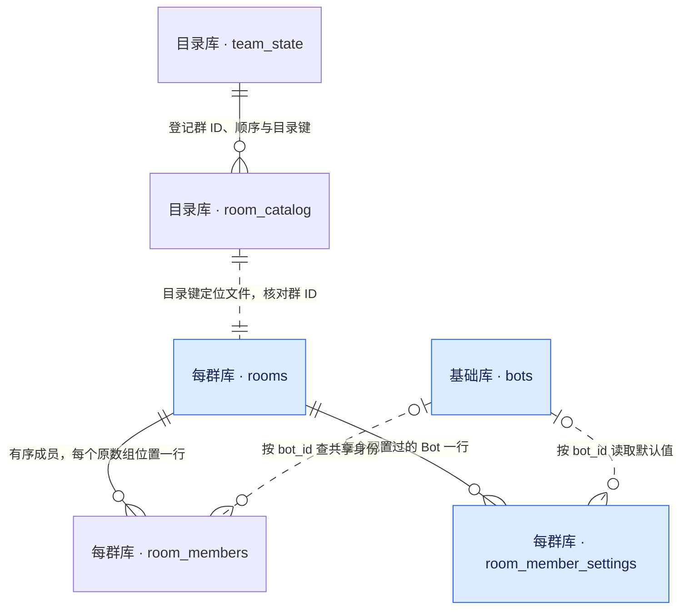
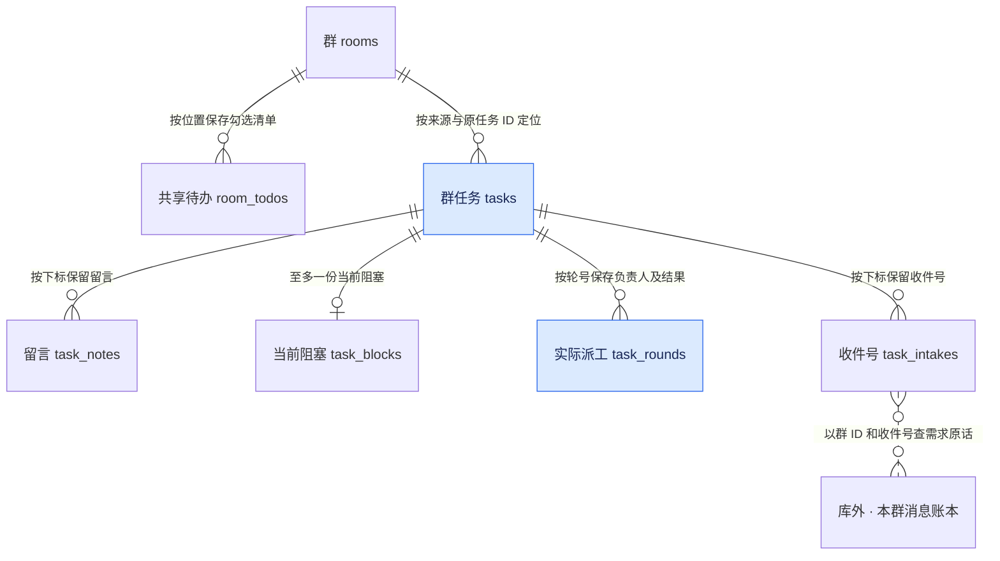

# 计划一 · Bot 基础资料与按群拆库的 SQLite 存储

**一个群一个 SQLite 文件，以稳定的群 ID 定位。一个 Bot 的基础资料只存一份，每个群可以为这个 Bot 单独设置工作目录和模型。** 插件把团队状态写入 `bot/state/`。首次启动可从旧 `bot/state.json` 或已经继续写入过的 `bot/team.sqlite` 导入。迁移范围为一份团队状态；群消息全文、附件、群记忆及 DSH 会话继续由各自的存储管理。[多库表结构与字段字典](../design/project-task-model.sql) · [运行中的拆库适配器](../../ds-bot/src/host/team-storage/split.js)

## 一、文件归属与定位

以下路径相对于同一个团队的数据目录 `bot/`。一个团队有 N 个群时，这份状态占用 **N + 2 个数据库**。现有的 `chat-index.sqlite` 和 `usage.sqlite` 分别负责会话检索和模型用量。

| 文件 | 保存什么 | 依据什么定位 |
| --- | --- | --- |
| `state/catalog.sqlite`，团队目录库 | `team_state` 保存团队根字段，`room_catalog` 保存群 ID、原枚举位置和目录键。主 Bot 列表、团队工作区、分组、跨群交接和请求回执均保存在这里。 | 每个团队一份。目录中每一行对应一个群文件。 |
| `state/bots.sqlite`，Bot 基础库 | `bots` 保存名册中的 Bot、默认模型与工作目录、角色、指令、权限、私聊会话和分段。未加入任何群的 Bot 也有自己的记录。 | 原 `bots` 映射键为 `bot_id`；保留对象内的原 `id` 和枚举位置。所有群共用这份基础资料。 |
| `state/rooms/<storage_key>/room.sqlite`，群库 | 本群唯一的 `rooms` 行、成员列表、群内成员配置、共享待办、两类任务及明细。群名、公告、管理员和群共用目录都是本库普通列。 | 先用原 `rooms` 映射键查目录，再打开对应文件并核对 `rooms.room_id`。 |

群名只保存在群库的 `rooms.name`。例如群 ID 为 `r-42` 时，文件为 `state/rooms/id-r-42/room.sqlite`，从“研发一群”改成“交付群”只更新名称。目录键的规则为：匹配 `[a-z0-9][a-z0-9_-]{0,63}` 的**完整** ID 使用 `id-` 加原 ID；其他 ID 使用 `h-` 加原 ID 的 UTF-8 字节的 SHA-256 小写十六进制值。原 ID 原样入表。这样能处理大小写不敏感的文件系统、重名群和含路径分隔符的历史 ID。目录键有唯一约束，碰撞或库内 ID 不一致时中止打开或发布。

### 库间实体关系（ER）

图中的实线表示库内外键，虚线表示存储层按原 ID 匹配。一个 Bot 可以加入多个群。某个群解散，其他群仍通过同一个 Bot ID 读取基础资料。



`room_members` 的键是 `(room_id, position)`，保留旧成员列表的顺序及重复值。配置表的键是 `(room_id, bot_id)`，同一个 Bot 在同一个群只有一份配置。读取当前成员时按 Bot ID 左连接配置及基础资料。导入时允许历史目录设置、管理员、执行者或留言作者指向已离开的成员或已删除的 Bot。成员列表完全按源数据生成；设置表中的残留键不会让旧成员重新入群。通过群设置新建或编辑配置时，校验该 Bot 仍是本群成员。

### 每个群文件中的任务关系



`task_pk` 是**群库内**的连接键。跨群查询先按目录定位文件，再按 `(room_id, source_kind, task_id)` 找任务；两个群可以有相同的任务 ID，甚至相同的 `task_pk`。成员登记与项目派工通过 `source_kind` 区分。项目当前负责人取最后一个实际轮次的 `owner_bot_id`。共享待办保留勾选列表。管理员受理、派工和任务图沿用独立的计划二。[成员任务](../../ds-bot/src/host/tasks.js) · [项目任务](../../ds-bot/src/host/project-tasks.js) · [计划二](2026-11-19-project-task-dispatch.md)

## 二、同一个 Bot 在不同群怎样取配置

| 设置 | 写入位置 | 该 Bot 在本群的取值 |
| --- | --- | --- |
| Bot 默认模型、默认目录 | 基础库 `bots.model / work_dir` | 私聊和选择继承的群使用基础设置。 |
| 本群模型 | 群库 `room_member_settings.model_override` | 非空时本群成员会话使用该模型；清空后再次读取 Bot 默认模型。设置针对这个成员的群会话。 |
| 本群目录 | 群库 `work_dir_rule / work_dir` | `override` 优先采用本成员的设置。路径表示指定目录，SQL NULL 表示明确使用团队工作区。选择 `inherit` 时依次取群共用目录、Bot 默认目录、团队工作区。 |
| 迁入的旧目录 | 同表的 `work_dir_rule='legacy'` | 沿用旧插件优先级：群共用目录优先；群没有共用目录时采用旧成员目录（包括显式使用团队工作区）。在群设置中重新指定后改为 `override`。 |

保留 `legacy` 能处理旧数据同时有 `rooms[r].workDir` 和 `memberDirs[b]` 的情况：首次迁移后 Bot 仍在原来的目录工作，旧成员路径也能完整导回。用户之后可以有意让某一个成员使用不同目录。修改本群配置只影响本群对应成员会话，沿用现有的目录访问检查、模型可用性检查和会话切换机制。[旧目录解析顺序](../../ds-bot/src/host/folders.js) · [群成员工作目录修改入口](../../ds-bot/src/host/tools.js) · [成员会话模型选择](../../ds-bot/src/host/groups.js)

例如，基础库中 `editor` 的默认模型是 M1、目录是 `/work/base`；群 A 和群 B 都有这个成员。在 A 群把模型设为 M2、目录设为 `/work/a`，成员配置只写 A 群文件中的这一行，团队修订号随本次保存推进。即使 A 群有共用目录，新的显式选择也优先。B 群和私聊继续依各自的设置取值。单独改模型也可以只有一行 `work_dir_rule='inherit'` 的记录。

写入成员目录时，已有的 `dir_position` 保留，新增的键追加到本群末尾，同时把群行的 `shape_json.memberDirs` 设为 `"object"`。恢复继承时清除该成员的目录值和位置；若还有群内模型，保留这条设置。只改模型不创建旧 `memberDirs` 键。群行的形态和成员设置在一个事务内更新，最后一个目录键移除后仍可区分空对象和业务显式删除整个属性。

## 三、原 state.json 如何无损拆分

按**旧加载器填默认值或修剪历史字段之前**的源快照迁移。列级对应、类型和可空语义在 SQL 的行尾注释中。一个原键有且只有一个保存位置。

| 源 JSON | 去向与还原规则 |
| --- | --- |
| 根对象中除 `bots / rooms` 以外的键 | `catalog.team_state` 各具名列承接版本、修订号、工作区、主 Bot 列表、归档、权限配置、各会话索引、交接、请求及偏好等。结构化字段保持完整 JSON 类型。旧版单主 Bot 等已定义旧键也有专列，其余根扩展保留在本行 `extra_json`。 |
| `bots[key]` | 写入基础库 `bots`。映射键、原对象内 `id`、`position` 分列；基础配置不按群重复写入。 |
| `rooms[key]` | 目录库保留映射键及 `position`。群库根行保留原对象内 `id`、当前 `sessionId`、群名、公告、管理员、权限、工作目录、群目标、各成员会话与已读位置、消息缓存、待处理队列及其余原字段。 |
| `members[] / memberDirs` | 前者按下标写 `room_members`。后者按映射键写 `room_member_settings`，保存 `dir_position` 与 `legacy` 规则。字符串原样存路径，显式 null 原样存 SQL NULL，缺键表示继承。即使没有当前成员行也保存该旧键。整个 `memberDirs` 缺失、为 null、为空对象三种形态由群行的 `shape_json` 区分。旧格式没有定义群内模型，导入时 `model_override` 一律为空，不根据当前会话猜测。 |
| `todos[]` | 每个数组位置一行，保存待办 ID、文本、勾选状态、创建与勾选的人员和时间。 |
| `tasks[key] / projectCards[key]` | 写 `tasks`，分别标为 `member / project`。保留原映射键、对象内 ID、顺序及各自字段。成员状态原样保存。项目显式状态按原值；缺状态键时按最后一轮推得 `review / active / delivered / assigned`（无轮次为 NULL），以 `shape_json.status="derived"` 标记。 |
| 任务的 `notes[] / blocked / intakes[] / rounds[]` | 各入同一群库的四张明细表。保留空阻塞对象、备注作者、错误码原类型、重复收件号、轮次顺序、负责人、方案、派工编号以及指派、送达、开工、提交的时间和结果。原消息及附件仍通过同群收件号回查。 |

普通列遇到显式 null 时，`shape_json` 保存键名及 `"null"` 标记；没有标记的 SQL NULL 还原为缺键。拆表的对象、数组用 `"object" / "array"` 标明原容器，零明细也能还原。每层未知键放在对应行的 `extra_json`，每个库用本地的 `known_json_keys` 和触发器阻止与已定义键重名。已知字段遇到不兼容类型时，报告源记录路径并停止切换。群内模型属于新增配置，历史 JSON 恰好有同名的未知扩展时，也保留其原名、原值，不将它解释成模型选择。

**回读对账。** 先从根行恢复团队字段，按基础库的 `position` 回填 `bots`，再按目录顺序逐群读取。根据 `dir_position` 重建 `memberDirs`，按下标或轮号组装其余子项；应用原 null 和空容器标记，合回本层扩展。派生项目状态须与最后一轮相符，导回时省去原先缺失的状态键。逐项比较键集合、值、类型、数组顺序、Bot/群/任务映射键及其枚举顺序；JSON 空白和缩进不参与比较。

## 四、首次切换、故障与回退

1. **选定权威来源。** 宿主先取得团队的 `state.lock`。另一个写入宿主仍在运行时只读，取得写锁后再固定迁移来源。若此团队已启用单库版并有更新，使用单库适配器读取的最新完整状态及修订号，保留现有任务行键；旧 JSON 仅供核对迁移时点。没有足够证据区分两个独立写入来源时停止切换。[现有单库读取接口](../../ds-bot/src/host/team-storage/sqlite.js)
2. **逐库构建。** 在同一文件系统下建立私有临时目录，按上表生成目录库、Bot 库和逐群的群库。每个文件单独提交并关闭。空团队也建前两个库，零个群就有零个群文件。
3. **对账后一次发布。** 各库分别通过完整性与外键检查，核对目录与群文件一一对应、文件内群 ID 和位置无误。跨库 Bot 引用分开核对当前关联与源数据中已有的历史缺项。完成上述全量回读比较，关闭数据库、同步文件及相关目录，然后在团队锁下将候选目录原子改名为正式 `state/`，同步父目录。崩溃后只选择完整且已发布的目录；正式目录缺库或 ID 错位时报告错误，保留数据并停止写入。未发布的构建可从同一权威来源重试。
4. **同一操作的跨库一致性。** 目录库作为磁盘主库，按操作挂载 Bot 库及涉及的群库。修改一个群的配置及团队修订号在同一事务提交。涉及多文件提交时统一使用回滚日志和完整同步。全量迁移逐群处理，避开 SQLite 同时挂载库数量的上限；超过上限的批量切换采用完整候选集发布，不能将多个独立提交视为一次原子提交。[SQLite 多文件事务说明](https://www.sqlite.org/lang_attach.html)
5. **退回旧版前做可表示性检查。** 切换前保留权威源。切换后若已有写入，必须导出最新状态并重新对账。旧插件无法表达新增的群内模型，或在群共用目录下优先生效的成员覆盖。存在这类设置时阻止降级并列出具体群和 Bot，保留多库数据；待用户显式处理差异后才切换。只迁入历史数据、尚无新配置时，可以重建原状态。

### 建表与验收

`project-task-model.sql` 中的 `@database catalog / bots / room` 分别标记三段 DDL（建表语句）。`main` 为目录库，`bot_base` 与 `room` 为连接别名。初始化示例在三个新建的临时文件上执行，下列示例通过 SQLite 命令行从仓库根目录运行；调用方创建数据库所在目录。增加第二个群时挂载它自己的新文件，只执行 `@database room` 段。每个连接开启外键，每次建库在事务中完成。

```sh
model="$PWD/docs/design/project-task-model.sql"
example_dir=$(mktemp -d)
(cd "$example_dir" && sqlite3 -bail catalog.sqlite \
  "ATTACH 'bots.sqlite' AS bot_base" "ATTACH 'room.sqlite' AS room" \
  "PRAGMA foreign_keys=ON" "BEGIN" ".read '$model'" "COMMIT")
```

验收使用隔离样本，覆盖两个同名群、同一个 Bot 在两群的不同设置、群改名、旧成员目录的缺失/null/空对象、已退群的历史引用、跨群同号任务、派工轮次和嵌套扩展字段，并演练发布前中断、已切换单库来源及新字段阻止降级。单独复制一个群库可以保留该群任务、历史 ID 和成员配置；在新环境显示完整 Bot 资料或需求原话时，须同时提供对应的 Bot 基础资料和群消息账本。[存储模型测试](../../ds-bot/test/team-storage.test.js) · [群消息账本](2026-11-10-message-ledger.md)

## 五、插件实施与本机交付计划

实施按下列顺序验收。模型样本验证字段和约束，隔离 Web 使用实际安装包验证用户可见行为。

| 顺序 | 工作 | 完成条件 |
| --- | --- | --- |
| 1. 接入多库存储和历史迁移 | 在现有存储接口内处理三种打开情形：新团队、仅有旧 JSON、已有单库。按第四节锁定权威来源、构建候选库、回读并发布。已发布的多库再次打开时直接使用。 | 在独立数据目录分别迁入两种历史来源，记录群数、Bot 数、任务和轮次数，重建源状态逐字段比较。已有单库的样例包含 JSON 备份之后的更新。演练失败重试、只读宿主及重启；原件可恢复。 |
| 2. 接入建群和成员配置 | 建群成功返回前完成群库初始化、目录登记和首批成员写入。群设置可按成员修改、清除模型和工作目录；成员会话的创建、后续使用和重启恢复都按第二节取值。 | 新群即使没有消息或任务也有独立文件和一期的 9 张表。二期群库版本 2 增加六张收件和派工表，版本 3 再增加两张阻塞和恢复表。见[二期增量明细](2026-11-19-project-task-dispatch.md)。改群名后文件路径相同。成员设置沿用现有权限和目录检查，其他群及 Bot 基础配置保持各自取值。既有待办、任务、历史轮次和分配流程通过针对性回归。 |
| 3. 隔离 Web 实测 | 用本次构建和模拟模型，在独立 Web 实例创建两个有相同 Bot 的群。为该 Bot 分别选不同目录和可用模型，再改、清除其中一群的覆盖。 | 经 Web 操作核对群库创建时点、成员设置回读、两个成员会话实际使用的目录与模型、私聊的默认值。重启 Web 后复验。记录测试结果，停止本次启动的服务。 |
| 4. Web 通过后安装到本机 DSH | 记录目标 DSH 配置档、已装插件实际来源及可恢复的版本，使用受支持的安装方式加载刚刚验证的插件包。用本机 DSH 和独立测试数据验收，记录桌面配置档实际加载的代码与生效状态。 | 区分工作区链接、已安装包和已运行的版本。交付时列出实际使用的数据库位置、两张 ER 图、两类来源的对账结果、Web 和本机 DSH 各自通过的场景；本机个人团队如仍待切换，单独注明。 |


## 六、如何查看数据与核对升级

从 DSH 的数据目录进入 `bot/state/`。打开 `catalog.sqlite`，用以下查询列出每个群对应的文件。创建一个群后就可以查到这一行，改名后使用原路径。

```sql
SELECT room_id, 'rooms/' || storage_key || '/room.sqlite' AS room_file
FROM room_catalog ORDER BY position;
```

在对应的 `room.sqlite` 执行下面的查询，可查看群公告、管理员以及本群给各成员设置的目录和模型。群任务状态见 `tasks.status`，实际执行者和各轮进展见与其 `task_pk` 关联的 `task_rounds`。

```sql
SELECT room_id, name, notice, admin_bot_id FROM rooms;
SELECT bot_id, work_dir_rule, work_dir, model_override FROM room_member_settings;
```

发布前对每个库运行 `integrity_check` 和 `foreign_key_check`。存储层回读整个团队，与迁移源比较每一层字段的值和类型、数组顺序及有业务顺序的映射键。旧单库的 `task_pk` 逐任务迁入相应群库。打开已有团队后，原有业务升级逻辑仍可能补默认值或推进修订号，首次导入的对账发生在这些业务操作之前。

2026-11-19 的隔离样本中，旧 JSON（修订 387）还原出 6 个 Bot 和 1 个群。旧单库（修订 7）还原出 2 个 Bot、2 个群、3 项任务和 1 个派工轮次；同目录的早期 JSON 只有 1 个群。两次回读与各自权威来源相等。双群 Web 验证同时检查模型服务收到的会话 ID、请求模型和 DSH 的实际会话目录。[拆库回归测试](../../ds-bot/test/split-team-storage.test.js) · [双群 Web 验证](../../ds-bot/dev/room-storage-smoke.mjs)

## 变更

- 2026-11-19 接入目录库、共享 Bot 基础库和逐群数据库，支持旧 JSON 与旧单库两种来源。群成员设置支持独立指定和恢复继承目录、模型。任务分配见独立的计划二。
