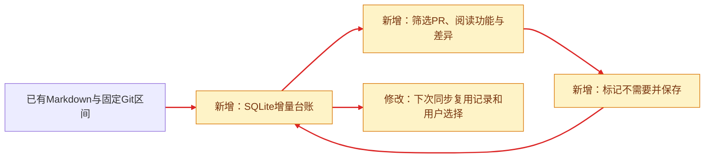

# 上游PR完整适配与增量台账

## Goal

1. 用户读懂每个PR的功能与本地价值，避免凭编号作决定。
2. 完整适配PR2028；用可保存选择、能筛选的本地页面减少重复盘点。

## Requirements

### R1 修改

- **R1.1**：同步技能当前只允许采用、需讨论、暂缓、跳过；历史片段另记版本与缺口。该规则修改已完成。
- **R1.2**：每个PR解释问题、触发场景、效果、用法、本地价值和限制，附来源；未采用给出差异和完整解法。
- **R1.3**：PR2028整条适用能力一起适配，保留本地UI外壳、入口、提示词、项目卡和并行会话；完整验证才采用和部署。
- **R1.4**：项目内SQLite首次导入265个既有键，后续按固定SHA增量、依赖和本地变更重审，去重保留时间及证据。
- **R1.5**：HTML支持状态/权重/依赖组/关键词/我的选择等筛选，能持久标记不需要和撤销，同步不能覆盖；标记不回滚已装代码。
- **R1.6**：upstream-changelog.md继续记录采用和验证。新批次仅独立分支；插件经独立验证才更新本机web/desktop，不合dev。

## User-visible Outcomes

- [x] **O1 (R1.1)**：技能和当前来源表不再使用部分采用状态，保留历史事实；2028完整采用后当前113项余数。
- [x] **O2 (R1.2, R1.3)**：PR2028用途、真实差异和完整验收已解释，实施/自动检查/独立复核与用户验收分别记录。
- [x] **O3 (R1.2, R1.4)**：页面首次加载现有PR，每项有说明与来源，重复导入不重复。
- [x] **O4 (R1.4, R1.5)**：筛选/标记并重启再同步，选择保留，增量只更新变化项。
- [x] **O5 (R1.3, R1.6)**：PR2028实际功能通过独立验收后打包安装，dev保持原样。

<!-- ui-prototype:START -->
- [ ] **O-PROTOTYPE** Current prototype: [entry](prototype/brief.md);
  preview: ;
  `prototype status: approved`; `digest: sha256:6b3cdfcc7e35de065729cf46bccecaaf96058287cd4b7fe888be40a464a78955`.
<!-- ui-prototype:END -->

文字布局方案已由用户2026-11-26批准；仅记录文字交互范围，最终界面未作用户验收。

### 交互变化

实现与独立验证、安装已经完成；最终界面仍待用户验收。[实施回执](../../reviews/2026-11-26-upstream-2028-implementation.md)。
